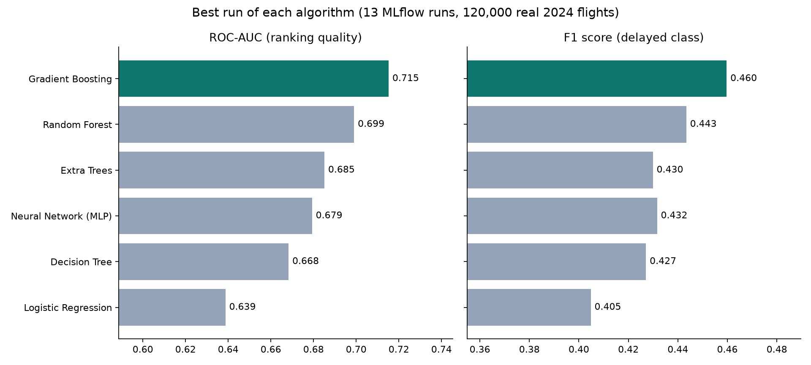

# Flight Delay Predictor

Predicts the probability that a US domestic flight arrives **15 or more minutes late**, explains
which factors drive the prediction, and uses a **local generative AI model** (Llama 3.2 via Ollama,
no API key) to turn the result into plain-English advice for the passenger.

CSL236 end-term project · Ishatv Mago (24csu082)

| Stage | What we built | Where |
|---|---|---|
| 1. Environment | Python 3.11 venv, pinned dependencies | `requirements.txt`, `requirements-serve.txt` |
| 2. Experiment tracking | MLflow (SQLite), 13 runs, 6 algorithms, 2 feature sets, tuning, 5-fold CV | `train.py`, `mlflow.db`, `compare_models.py` |
| 3. Model artifact | MLflow Model Registry (`flight-delay-model`, alias `production`); pipeline saved once, loaded once at API startup | `model/model.joblib`, `model/metadata.json` |
| 4. API + UI | FastAPI `/health`, `/predict`, `/explain`, `/alternatives`; React UI served at `/` | `app.py`, `static/`, `frontend/` |
| 5. Tests | 22 pytest cases: health, UI, domain logic, date features, 422 boundaries, fallback, logging | `tests/test_app.py` |
| 6. Container | `python:3.11-slim`, serve-only requirements, health check | `Dockerfile` |
| 7. CI | GitHub Actions: install → train baseline → pytest → Docker build + smoke test | `.github/workflows/ci.yml` |
| 8. Deploy + monitoring | Render free tier, every prediction logged, drift check | `logs/predictions.jsonl`, `drift_check.py` |

---

## 1. Data

**Source:** US Bureau of Transportation Statistics (BTS), *Reporting Carrier On-Time Performance*
(transtats.bts.gov). Public US government data, no account or API key.

`download_data.py` downloads **all 12 months of 2024** — **6,965,247 completed flights** after
removing cancelled and diverted ones — keeps flights between the 20 busiest airports and takes a
random sample of **120,000 flights** (about 10,000 per month, seed 42) saved as `data/flights.csv` (3.3 MB).

- Target: `delayed` = 1 if the flight arrived ≥ 15 minutes late (official US DOT definition)
- Class balance: **22.3 % delayed**, 77.7 % on time → we use F1 and ROC-AUC, not just accuracy
- Busiest delay month: July (32 % delayed); best: October (13.5 %). Worst departure hour: 19:00 (32 %); best: 05:00 (9 %)

### Data contract (`POST /predict`, `POST /explain`)

| Field | Type | Rule | Example |
|---|---|---|---|
| `flight_date` | date | `YYYY-MM-DD`, 2024-01-01 – 2030-12-31 | "2026-11-25" |
| `dep_hour` | int | 0 – 23 (scheduled departure, 24 h) | 18 |
| `distance` | int | 50 – 5000 miles | 802 |
| `airline` | string | 2-letter IATA code from the training data (AA, AS, B6, DL, F9, MQ, NK, OH, OO, UA, WN, YX, 9E) | "AA" |
| `origin` | string | 3-letter IATA code of one of the 20 airports in the training data | "DFW" |
| `dest` | string | same as origin, and **must differ from origin** | "ORD" |

The API turns `flight_date` into the month, day of week, day of month and the number of days to the
nearest US federal holiday (`features.py`, shared with training so both compute them the same way).
Codes are case-insensitive. Any violation (missing field, out of range, unknown code, same airports)
returns **HTTP 422** with the reason.

Example response:

```json
{
  "delay_probability": 0.636,
  "prediction": "Delayed",
  "risk_level": "High",
  "reasons": [
    {"feature": "month", "label": "month of travel", "value": 11, "impact": -0.179},
    {"feature": "airline", "label": "airline", "value": "AA", "impact": 0.096},
    {"feature": "dep_hour", "label": "departure time", "value": 18, "impact": 0.08}
  ],
  "tips": ["Evening flights pick up delays from earlier in the day. Morning departures (before 9 am) were delayed only 9% of the time."]
}
```

---

## 2. Model and experiments

Features: `month`, `day_of_month`, `day_of_week`, `days_to_holiday`, `dep_hour`, `distance` (numeric)
and `airline`, `origin`, `dest` (one-hot encoded). `days_to_holiday` is engineered from the date with
the US federal holiday calendar (0 = on the holiday, capped at 14). Stratified 80/20 train/test split, `class_weight="balanced"` for the minority class.

**Experiment 1 — schedule features only** (`--feature_set base`, 7 features)

| Run | Algorithm | Hyperparameters | Accuracy | Precision | Recall | F1 | ROC-AUC |
|---|---|---|---|---|---|---|---|
| 1 | Logistic Regression (baseline) | C=1.0 | 0.607 | 0.305 | 0.601 | 0.405 | 0.638 |
| 2 | Random Forest | 100 trees, depth 8 | 0.619 | 0.317 | 0.616 | 0.418 | 0.667 |
| 3 | Random Forest | 200 trees, depth 16 | 0.646 | 0.335 | 0.598 | 0.429 | 0.682 |
| 4 | Gradient Boosting | 300 rounds, lr 0.1 | 0.644 | 0.337 | 0.619 | 0.436 | 0.688 |

**Experiment 2 — adding date features** (`--feature_set date`: + day of month, days to nearest holiday)

| Run | Algorithm | Hyperparameters | Accuracy | Precision | Recall | F1 | ROC-AUC |
|---|---|---|---|---|---|---|---|
| 5 | Logistic Regression | C=1.0 | 0.606 | 0.305 | 0.602 | 0.405 | 0.639 |
| 6 | Random Forest | 200 trees, depth 16 | 0.664 | 0.351 | 0.602 | 0.443 | 0.699 |
| 7 | Gradient Boosting | 300 rounds, lr 0.1, 31 leaves | 0.670 | 0.360 | 0.623 | 0.457 | 0.712 |
| 8 | Gradient Boosting (tuned) | 500 rounds, lr 0.1, 63 leaves | 0.681 | 0.370 | 0.613 | 0.461 | 0.715 |
| 9 | **Gradient Boosting (chosen)** | 800 rounds, lr 0.05, 63 leaves, L2 1.0 | 0.674 | 0.364 | **0.624** | 0.460 | **0.715** |

**Experiment 3 — more algorithms** (date features), to check that no other model family does better

| Run | Algorithm | Hyperparameters | Accuracy | Precision | Recall | F1 | ROC-AUC |
|---|---|---|---|---|---|---|---|
| 10 | Decision Tree | depth 10 | 0.644 | 0.333 | 0.597 | 0.427 | 0.668 |
| 11 | Extra Trees | 300 trees, depth 20 | 0.667 | 0.347 | 0.563 | 0.430 | 0.685 |
| 12 | Neural Network (MLP) | layers 128-64, alpha 0.001 | 0.631 | 0.329 | 0.629 | 0.432 | 0.679 |
| 13 | Gradient Boosting (run 9) + **5-fold cross-validation** | as run 9 | 0.674 | 0.364 | 0.624 | 0.460 | 0.715 (CV **0.716 ± 0.003**) |



`python compare_models.py` rebuilds this chart and a table of every run (`reports/model_comparison.md`)
from MLflow.

**What we learned**

- The date features raised ROC-AUC from 0.688 to 0.712 for Gradient Boosting and from 0.682 to 0.699
  for Random Forest, but did nothing for Logistic Regression: holiday effects go up and down (see
  below), and a linear model cannot represent that, while tree models can.
- Tuning added a further +0.003 ROC-AUC. Runs 8 and 9 are effectively tied; we chose run 9 for the
  highest recall (it catches the most real delays) and its regularisation (lower learning rate, L2).
- Across six model families Gradient Boosting is best on ROC-AUC and F1. A single Decision Tree is the
  weakest tree model (0.668): averaging or boosting many trees is what helps. The neural network (0.679)
  does not beat tree ensembles, which is typical for tabular data of this size.
- 5-fold cross-validation gives ROC-AUC 0.716 ± 0.003 for the chosen model, so its score is stable
  across different train/test splits and not the luck of one split.
- Experiments are only logged to MLflow; the model served by the API is replaced only with `--save`
  or `--register`.
- Gradient Boosting uses **early stopping**: it holds back 10 % of the training data and stops adding
  trees when the validation score stops improving. Run 9 built 235 of the allowed 800 trees
  (`trees_built` metric in MLflow), which prevents overfitting.
- Run 9 is registered in the **MLflow Model Registry** as `flight-delay-model` with the alias
  `production` (`python train.py ... --register`). The model file is 1.7 MB.

Precision is around 0.33 because only 22 % of flights are delayed: with `class_weight="balanced"` the
model prefers to warn about a risky flight rather than miss a real delay.

**Holiday finding:** in 2024 the delay rate within 3 days of a holiday depended on the holiday:
Martin Luther King Jr. Day 35 % (a January winter storm) and Memorial Day 31 % were far worse than
normal days (22 %), while Thanksgiving (18 %) and Veterans Day (14 %) were better. The API's travel tip
quotes the rate for the specific holiday instead of assuming every holiday is bad.

The model only knows the schedule, not weather or technical faults, so a ROC-AUC around 0.68 is in
line with published schedule-only delay models.

**Explanations:** for each prediction the API replaces one input at a time with its most typical
training value and measures how much the probability changes (occlusion / perturbation importance).

**Safer alternatives:** `/alternatives` takes the same flight and asks the model about small
changes: a departure time within 3 hours, the safest time of the day, another airline that really
flew this route in 2024, and dates up to 3 days earlier or later. All variations are scored in one
batch and the best one of each kind is returned if it lowers the delay probability by at least 3
points. In the UI, "Use this" fills the form with that option and forecasts it.

**Generative AI:** `/explain` sends only the model's facts (probability, reasons, tips) to Llama 3.2
running locally through Ollama. The LLM never makes the prediction; it only explains it. If Ollama is
not running (CI, Docker, cloud) the API returns a template explanation instead, so nothing breaks.

**Route map:** the prediction page shows an animated map (curved route, a plane flying it, route
coloured by the predicted risk). A switch chooses the background: **Dark**, **Streets** or
**Satellite** load free public map tiles from Esri and OpenStreetMap (no API key, credited on the map),
and **Offline** draws the US states from a GeoJSON file bundled in `frontend/src/data/`. If the online
tiles cannot load, the map switches to Offline by itself. The map is only the picture: every
prediction comes from our own trained model.

---

## 3. Run it locally

```bash
python3.11 -m venv .venv
source .venv/bin/activate
pip install -r requirements.txt

python download_data.py                  # optional: data/flights.csv is already in the repo
python train.py --algorithm gb --max_iter 800 --learning_rate 0.05 --max_leaf_nodes 63 --l2 1.0 --register
uvicorn app:app --port 8000              # open http://localhost:8000
```

Other experiments:

```bash
python train.py --algorithm logreg
python train.py --algorithm rf --n_estimators 200 --max_depth 16
python train.py --algorithm gb --feature_set base       # without the date features
python train.py --algorithm dt --max_depth 10           # Decision Tree
python train.py --algorithm et --n_estimators 300 --max_depth 20   # Extra Trees
python train.py --algorithm mlp --hidden 128,64 --alpha 0.001      # neural network
python train.py --algorithm gb --max_iter 800 --learning_rate 0.05 --max_leaf_nodes 63 --l2 1.0 --cv 5
python compare_models.py                                # chart + table of all runs in reports/
mlflow ui --backend-store-uri sqlite:///mlflow.db --port 5001   # compare runs
```

Optional local AI explanations: install [Ollama](https://ollama.com), run `ollama pull llama3.2:3b`,
keep Ollama open, then use the **Explain in plain English** button.

Frontend development (hot reload on port 5173, API proxied to port 8000):

```bash
cd frontend && npm install && npm run dev
npm run build     # writes the production UI into ../static
```

## 4. Tests

```bash
pytest -v
```

22 tests: health check, UI loads, prediction shape, two domain-logic checks (evening riskier than
early morning; July riskier than October), date features (2026-11-25 is a Wednesday, 1 day from
Thanksgiving), nine invalid-input 422 cases, same-airport 422, missing
field 422, lower-case codes accepted, LLM template fallback, prediction logging, and safer alternatives (each suggestion is safer than
the original, airlines only from the route's real carriers, invalid input rejected).

## 5. Docker

```bash
docker build -t flight-delay-api .
docker run -d --restart unless-stopped -p 8000:8000 --name flight-delay flight-delay-api
curl localhost:8000/health
```

To let the container use Ollama running on your Mac:
`docker run -p 8000:8000 -e OLLAMA_URL=http://host.docker.internal:11434 flight-delay-api`

## 6. CI

`.github/workflows/ci.yml` runs on every push and pull request: install `requirements.txt` → train
the baseline model → `pytest` → build the Docker image and check `/health` inside the container.

## 7. Deployment (Render free tier)

1. render.com → **New → Web Service** → connect this GitHub repository.
2. Runtime: **Docker** (Render uses the `Dockerfile` and passes `$PORT`).
3. Instance type: **Free**. Environment variable: `ENABLE_LLM=0`.
4. Health check path: `/health`. Render restarts the container automatically if it crashes.

## 8. Monitoring and drift

Every `/predict` call is appended to `logs/predictions.jsonl`. `drift_check.py` compares those live
inputs with the training statistics in `model/metadata.json` and exits with code 1 if drift is found:

```bash
python drift_check.py
```

## Project structure

```
├── app.py                 FastAPI app: API + serves the UI
├── train.py               training with MLflow tracking (CLI hyperparameters)
├── download_data.py       builds data/flights.csv from BTS
├── features.py            date features shared by training and the API
├── drift_check.py         compares live inputs with training data
├── compare_models.py      chart + table comparing all MLflow runs (reports/)
├── data/flights.csv       120,000 real flights (all of 2024)
├── model/                 model.joblib + metadata.json (metrics, allowed values, statistics)
├── static/                built React UI (served at /)
├── frontend/              React + Vite + Tailwind source
├── tests/test_app.py      pytest suite
├── Dockerfile, .dockerignore
├── requirements.txt       full environment (training + tests)
├── requirements-serve.txt runtime only (Docker)
└── .github/workflows/ci.yml
```

## Limitations

- Trained on 2024 only; a new year's schedules or airline changes need retraining (see drift check).
- Schedule features only: no weather, aircraft or crew data, which cause many real delays.
- 20 busiest US airports only.
